<div align="center">

# 🔥 Prometheus

### Watchtowers for data on [Arkiv](https://arkiv.network)

**Get warned before your data expires. Hear when it's gone, changed, or when something new matches. Or let Prometheus keep it alive for you.**
**Every action leaves a public, tamper-evident receipt on chain.**

[](https://prometheus-arkiv.vercel.app)
[](https://t.me/prometheus_arkiv_bot)
[](https://www.npmjs.com/package/prometheus-arkiv)
[](LICENSE)


[Live app](https://prometheus-arkiv.vercel.app) · [Docs](https://prometheus-arkiv.vercel.app/docs) · [SDK](sdk/README.md) · [Telegram bot](https://t.me/prometheus_arkiv_bot) · [Activity](https://prometheus-arkiv.vercel.app/activity)

</div>

---

## 📑 Table of contents

1. [The problem: data that dies in silence](#%EF%B8%8F-the-problem-data-that-dies-in-silence)
2. [The solution: Prometheus in one picture](#-the-solution-prometheus-in-one-picture)
3. [The five triggers](#-the-five-triggers)
4. [Get started in 60 seconds](#-get-started-in-60-seconds)
   - [No code: Telegram](#path-1--no-code-telegram)
   - [Developers: the SDK](#path-2--developers-the-sdk)
   - [Without the SDK](#path-3--without-the-sdk-raw-arkiv)
   - [AI coding agents](#path-4--ai-coding-agents)
5. [Architecture](#%EF%B8%8F-architecture)
6. [How an alert travels, end to end](#-how-an-alert-travels-end-to-end)
7. [Two workers, zero coordination](#-two-workers-zero-coordination)
8. [Inside a worker](#-inside-a-worker)
9. [Data on Arkiv: the three entities](#%EF%B8%8F-data-on-arkiv-the-three-entities)
10. [Trust model: who you have to believe](#%EF%B8%8F-trust-model-who-you-have-to-believe)
11. [Limits](#-limits)
12. [The web app](#-the-web-app)
13. [The relay](#-the-relay)
14. [Repository tour](#%EF%B8%8F-repository-tour)
15. [Run it locally](#-run-it-locally)
16. [Deploy](#-deploy)
17. [Run your own worker](#%EF%B8%8F-run-your-own-worker)
18. [Proof: the failover rehearsal](#-proof-the-failover-rehearsal)
19. [What we learned building on Arkiv](#-what-we-learned-building-on-arkiv)
20. [Known limits](#-known-limits)
21. [What's next](#-whats-next)
22. [FAQ](#-faq)
23. [Glossary](#-glossary)
24. [License](#-license)

---

## 🕳️ The problem: data that dies in silence

[Arkiv](https://arkiv.network) is a database built for Ethereum. Every record in it is called an **entity**, and every entity has an **expiry block**. When that block arrives, Arkiv deletes the entity.

That's a great property: storage cleans itself up. But Arkiv's own documentation says what happens at that moment:

> _"An entity that reaches its expiration date fires no event."_

Nothing tells you. No log, no callback, no webhook. You only find out if you go and look.

For a lot of apps, **that silent moment is the most important moment there is**, and the people who lose out are real. In this buildathon alone, **several teams shipped a renew button that a person has to remember to press, or built their own watcher process** (cron jobs, polling loops, always-on listeners), for example:

| App (team)                                                                                                              | Who is harmed today                                                                                                                                                            | What the team had to build                                                                      | What changes on day one with Prometheus                                                                     |
| ----------------------------------------------------------------------------------------------------------------------- | ------------------------------------------------------------------------------------------------------------------------------------------------------------------------------ | ----------------------------------------------------------------------------------------------- | ----------------------------------------------------------------------------------------------------------- |
| [Nexora Ledger](https://github.com/GuTS805/Nexora)                                                                      | **Gig workers in India.** A record of what a job paid, or what went wrong, expires when no one presses "Keep alive +30 days" in time                                           | The keep-alive button, plus its own event listener and polling loop                             | 🟢 `keep` renews the record before it lapses. A worker pays the fee and writes a `kept` receipt             |
| [Fine Print Ledger](https://github.com/ShenJun93/fine-print-ledger)                                                     | **Hackathon entrants** proving a contest changed its rules. A rules snapshot that nobody cited lapses after 180 days                                                           | A "cite" button that extends the snapshot, and a snapshotter that re-checks pages to renew them | 🟢 `keep` holds the snapshot you rely on. ✨ `new_match` pings you when a new diff for your contest appears |
| [SiteLog](https://github.com/ttimesai-star/sitelog)                                                                     | **Construction site teams.** An open defect remark disappears after 90 quiet days, with its photo and norm reference                                                           | An "extend remark" button                                                                       | 🟠 `expiring` warns the site a day ahead, or 🟢 `keep` renews it                                            |
| [Lapse](https://github.com/northstar-trustrail/lapse) and [Arkiv Canary](https://gitlab.com/davidj-builds/arkiv-canary) | **Users of VPNs and mail providers.** A dead warrant canary gets "missed, since nobody is watching a static page for a renewal that didn't happen" (Lapse's README)            | A renew flow for the publisher, plus `lapse check` and a monitor CLI you "drop in cron"         | 🔴 `expired` sends a Telegram ping. No cron, no server. Prometheus **never** renews a canary                |
| [Door Ledger](https://github.com/bongbongcrypto/door-ledger)                                                            | **Traders with funds stuck behind an exchange halt.** Halt rows "lapse unless renewed" by the team's own watchers, and halts show on a page you must check; nothing alerts you | Two always-on Python watchers and a polling consumer                                            | ✨ `new_match` on halts for your exchange sends a Telegram ping, for anyone, not just the author            |
| [Tacho](https://github.com/Minkhanov/tacho-arkiv)                                                                       | **Merchants paid by an AI agent.** The agent's spending mandate lapses silently when the human stops renewing it                                                               | A human heartbeat button, a 30-second polling loop and a WebSocket listener                     | 🔴 `expired` and 🔵 `changed` on the mandate tell the merchant the moment its authority ends                |

None of these needs the app team's permission. Anyone can subscribe to any public entity, today.

And expiry is only one blind spot. Arkiv does emit events for edits and new entities, but to use them you have to run your own always-on listener, handle reconnects, replay gaps after downtime, and pay for the infrastructure. The teams above each rebuilt that watchtower for their own data, and none of them can run it for yours.

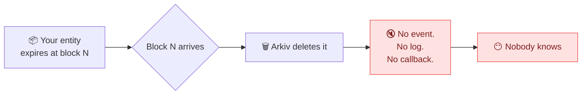

---

## 💡 The solution: Prometheus in one picture

Prometheus is a shared, open-source watchtower for Arkiv. You tell it what to watch **by writing an entity on Arkiv yourself**. Independent workers watch the chain, act at the right block, and **prove** what they did with a public receipt. A relay turns receipts into Telegram messages.

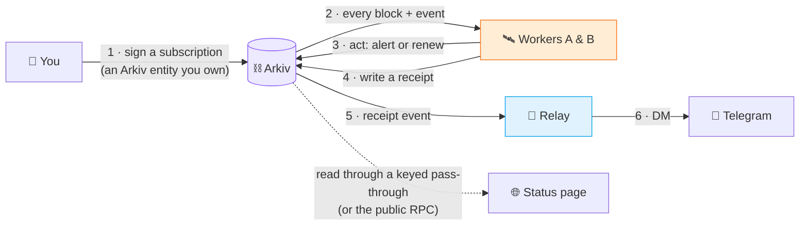

Three ideas make it work:

| Idea                                | What it means                                                                                                                                                                            |
| ----------------------------------- | ---------------------------------------------------------------------------------------------------------------------------------------------------------------------------------------- |
| 🧾 **Subscriptions live on chain**  | No sign-up, no API key, no backend database of users. Your subscription is a public Arkiv entity, signed by your wallet. If Prometheus vanished, anyone could run the code and serve it. |
| 🛰️ **Two workers, no coordination** | Worker A (New York) acts at once. Worker B (San Francisco) waits 30 s and acts only if A didn't. They never talk: they read each other's receipts on Arkiv.                              |
| 🔏 **Every action is provable**     | Each action writes a read-only **receipt** entity with the block the condition came true and the block the worker acted. You can audit timeliness yourself.                              |

---

## 🎯 The five triggers

Every subscription picks exactly one **trigger**:

| Trigger     | What Prometheus does                                                          | You give it                                  | Receipts it can write                                     |
| ----------- | ----------------------------------------------------------------------------- | -------------------------------------------- | --------------------------------------------------------- |
| `expiring`  | 🟠 Warns you a set time **before** the entity expires, while you can renew it | Entity key + warning time (1 min – 1 day)    | `warned`                                                  |
| `expired`   | 🔴 Tells you once the entity **has expired**: "not renewed by block X"        | Entity key                                   | `expired`                                                 |
| `changed`   | 🔵 Tells you when the entity is **edited, transferred or deleted**            | Entity key                                   | `patched`, `owner_changed`, `deleted`                     |
| `new_match` | ✨ Tells you when a **new entity matching a search** is created               | A search (+ optional creator address)        | `matched`                                                 |
| `keep`      | 🟢 **Renews** the entity before it expires, paying the fee for you            | Entity key + when to renew + how much to add | `kept`, `keep_skipped`, `keep_failed`, `keeper_low_funds` |

> [!TIP]
> You **don't need to own** the entity you watch. Any live Arkiv entity works. Its **key** is `0x` + 64 hex characters.

<details>
<summary><b>🔎 Trigger edge cases worth knowing</b> (click to expand)</summary>

**`expiring`**

- A warning time longer than the time left fires **at once** (and shows as "late", because its trigger block is in the past).
- A renewal **re-arms** the warning: each new expiry is a new trigger.

**`expired`**

- A **delete is not an expiry**. Use `changed` to hear about deletes.
- The only trigger that accepts a target that's already gone. If its last create or extend was in the last 24 h, the worker finds its real expiry block in the logs and still writes the receipt.

**`changed`**

- A **renewal is not a change**. Extending expiry fires nothing here.
- Several changes of one kind in one block produce one receipt.

**`new_match`**

- New entities only: a patch that makes an old entity match isn't seen.
- Searches are a JSON tree (`and`, `or`, `not`, `eq`, `gt`, `gte`, `lt`, `lte`, `startsWith`), at most 3 levels deep and 8 conditions. Values name their type (`{ "u64": 4 }`), because a bare `4` would silently match nothing.
- Prometheus's own writes (receipts) never match, so a search can't fire on itself.

**`keep`**

- Works only on entities created with `permissionlessExtension: true` (Arkiv's rule for non-owner renewals).
- **Never renews canaries or heartbeats.** Their expiry _is_ the signal. Any target whose `kind` or `project` contains `canary`, `heartbeat`, `liveness`, `deadman`, `keepalive` or `watchdog` (a separator is allowed, like `dead-man` or `heart_beat`) is refused with `keep_skipped(deny_listed)`, and so is any Prometheus entity.
- Renewal and its `kept` receipt go in **one transaction**: a `kept` receipt exists only if the renewal landed.
- Each worker renews at most 200 times per UTC day and stops below 0.005 GLM.

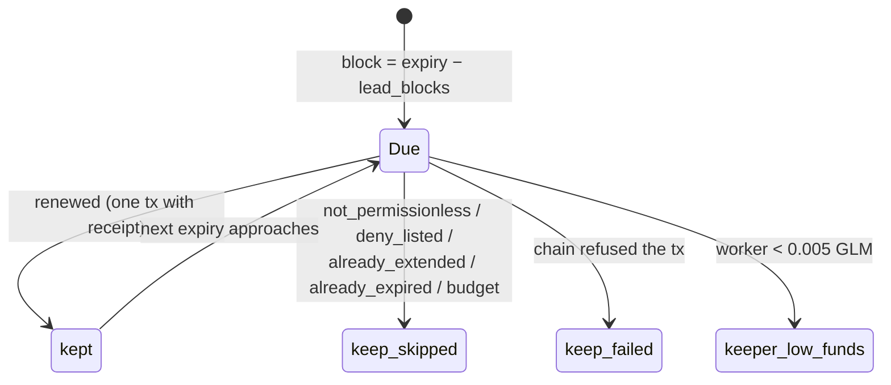

</details>

---

## 🚀 Get started in 60 seconds

Pick your path:

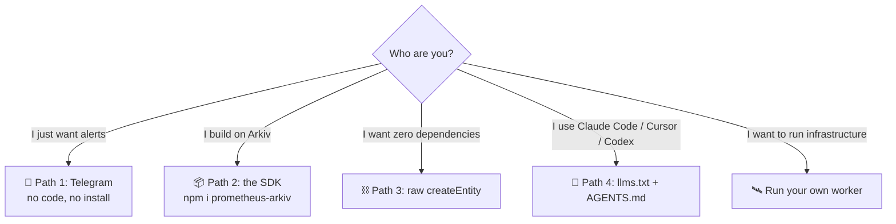

### Path 1 · No code: Telegram

1. Open **[@prometheus_arkiv_bot](https://t.me/prometheus_arkiv_bot)** and tap **Start**, then **Open Prometheus** (the Mini App).
2. Tap **Create wallet**. On iOS and Android the key is kept in Telegram SecureStorage (Keychain / Keystore); on Telegram Desktop and Web, in Telegram DeviceStorage. It never leaves the device.
3. Open the wallet menu → **Get free GLM to start**. The relay sends 0.02 testnet GLM, once per Telegram account.
4. Open the **New** (+) tab, or tap **Try it yourself** on Home. Then: **What should happen** (pick one, **Continue**) → **What to watch** (paste the entity key, **Continue**) → **Timing** (**Continue**) → **Name it and sign** (write a label).
5. The form checks your choices **against the workers' own code** as you type. When it says _"Workers will accept this subscription."_, tap **Sign and create**.
6. You see **Subscription created**. Tap **Get alerts in Telegram**. The bot replies `✅ Following "<label>"`.

What an alert looks like:

```text
🟠 EXPIRING SOON · Acme canary
Block 1234567.

Status: https://prometheus-arkiv.vercel.app/s/0x…
Target: https://tiramisu.explorer.arkiv.network/entity/0x…
Receipt: https://tiramisu.explorer.arkiv.network/entity/0x…
Tx: https://tiramisu.explorer.arkiv.network/tx/0x…
```

The **Status** line shows when the relay has `WEB_URL` set.

Bot commands: `/list` (what you follow), `/stop <n>` (unfollow). The bot works in private chats only and **never asks you to sign anything**: a message that does is phishing.

### Path 2 · Developers: the SDK

```bash
npm i prometheus-arkiv @arkiv-network/sdk viem
```

```ts
import { createWalletClient } from "@arkiv-network/sdk";
import { tiramisu } from "@arkiv-network/sdk/chains";
import { http } from "viem";
import { privateKeyToAccount } from "viem/accounts";
import { Prometheus } from "prometheus-arkiv";

const wallet = createWalletClient({
  chain: tiramisu,
  transport: http(),
  account: privateKeyToAccount(process.env.PRIVATE_KEY as `0x${string}`),
});
const prometheus = new Prometheus({ wallet });

const sub = await prometheus.watch.expiring("0x…entity key…", {
  before: "1h", // warn an hour before expiry
  for: "7d", // the subscription itself runs a week
  label: "Our canary", // shown in every alert
});

console.log(sub.telegramUrl); // open it, tap Start, done
```

**The SDK runs the workers' own decoder and checks the target, `keep` eligibility, your 20-subscription cap and your balance before signing.** All of those reads are free. A failed check throws a `PrometheusError` with a `code` and a sentence you can show a user.

<details>
<summary><b>📘 Full SDK cheat-sheet</b></summary>

| Method                                                           | Does                                             |
| ---------------------------------------------------------------- | ------------------------------------------------ |
| `watch.expiring(target, { before, for?, label })`                | Warn before expiry                               |
| `watch.expired(target, { for?, label })`                         | Tell once expired                                |
| `watch.changed(target, { for?, label })`                         | Tell on edit / transfer / delete                 |
| `watch.keep(target, { before, extendBy, for?, label, public? })` | Keep alive                                       |
| `watch.newMatch({ where, createdBy?, for?, label })`             | Tell on new matching entity (equality `where`)   |
| `check.<trigger>(…same args)`                                    | Run every check, sign nothing                    |
| `renew(key, "30d")`                                              | Run the subscription 30 days from now            |
| `cancel(key)`                                                    | Delete the subscription; workers stop at once    |
| `get(key)`                                                       | The subscription as workers decode it, or `null` |
| `receipts(key)`                                                  | Trusted receipts, newest first                   |

Durations are strings: `"30s"`, `"10m"`, `"1h"`, `"7d"` (seconds must be even: one block = 2 s).

In a browser, pass a wallet client built from `window.ethereum` with `custom(window.ethereum)` so the user signs and your page never sees a key.

Full reference with every error code: [`sdk/README.md`](sdk/README.md).

</details>

### Path 3 · Without the SDK (raw Arkiv)

A subscription is just an entity. Any Arkiv client can create one:

| Attribute     | Type | Value                                                     |
| ------------- | ---- | --------------------------------------------------------- |
| `project`     | str  | `prometheus`                                              |
| `kind`        | str  | `subscription`                                            |
| `trigger`     | str  | `expiring` · `expired` · `changed` · `new_match` · `keep` |
| `target_key`  | key  | the watched entity (not for `new_match`)                  |
| `lead_blocks` | u64  | `expiring` / `keep`: 30 – 43,200                          |
| `keep_blocks` | u64  | `keep`: 1,800 – 1,296,000 and > `lead_blocks`             |
| `max_per_day` | u64  | optional, 1 – 100 (default 20)                            |

Payload: `{ "v": 1, "label": "…" }` (plus `"search": {…}` for `new_match`). Every number **must be `u64`**. See [Without the SDK](web/docs/without-the-sdk.md) and the [Data contract](web/docs/data-contract.md).

### Path 4 · AI coding agents

The site publishes [`/llms.txt`](https://prometheus-arkiv.vercel.app/llms.txt) (index) and [`/llms-full.txt`](https://prometheus-arkiv.vercel.app/llms-full.txt) (every page in one file), generated from `web/docs` at build time. Paste a prompt like:

```text
Read https://prometheus-arkiv.vercel.app/llms.txt.
Then add a Prometheus watch with the prometheus-arkiv SDK: warn me 1 hour before
entity <key> expires, label "<label>", for 7 days. Sign with the user's own wallet client.
```

A ready-to-paste `AGENTS.md` / `CLAUDE.md` block is in [For agents](web/docs/for-agents.md).

---

## 🏗️ Architecture

Prometheus has **five parts** and one source of truth: **Arkiv itself**.

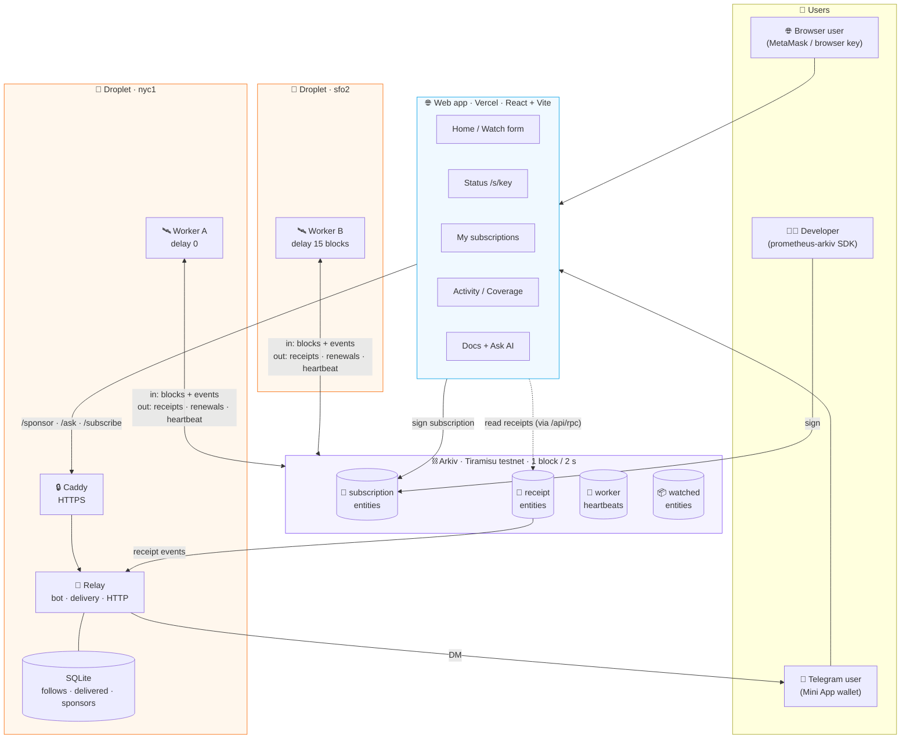

| Part           | Code                | Runs on                        | Job                                                                                        | State                                                                             |
| -------------- | ------------------- | ------------------------------ | ------------------------------------------------------------------------------------------ | --------------------------------------------------------------------------------- |
| 🛰️ **Worker**  | [`worker/`](worker) | Docker, 2 hosts in 2 regions   | Watch every block, decide triggers, write receipts, renew `keep` targets, prove it's alive | checkpoint, unsent receipts, heartbeat key (files)                                |
| 📨 **Relay**   | [`relay/`](relay)   | Docker, beside worker A        | DM trusted receipts on Telegram; run the bot; `/health`, `/sponsor`, `/ask`, `/subscribe`  | SQLite: follows, delivered trigger ids, sponsor claims, newsletter emails         |
| 🌐 **Web app** | [`web/`](web)       | Vercel (static + one function) | Watch form, status pages, my subscriptions, activity, docs; also the Telegram Mini App     | none (reads Arkiv through the keyed pass-through `api/rpc.ts`, or the public RPC) |
| 📦 **SDK**     | [`sdk/`](sdk)       | your app                       | Build, validate and sign subscriptions from code                                           | none                                                                              |
| 🧩 **Shared**  | [`shared/`](shared) | imported by all of the above   | Schema, the subscription decoder, trigger ids, the replaying event stream, Arkiv clients   | —                                                                                 |

> [!IMPORTANT]
> **The form and the SDK check with the workers' own code.** [`shared/subscription.ts`](shared/subscription.ts) is the decoder workers use to accept or reject a subscription, and the web form imports the very same function. The SDK runs the workers' own decoder and checks the target, keep eligibility, your 20-subscription cap and your balance before signing.

### Design principles

- **Arkiv is the database.** Subscriptions, receipts and liveness all live on chain. Off chain stay only personal data (Telegram follows, sponsor claims, newsletter emails in `relay.db`; chat ids never go on chain, not even hashed), secrets (bot token, private keys) and restart bookkeeping (checkpoints, delivered ids).
- **Free reads on the hot path.** Per-block work uses `arkiv_getEntity` and `arkiv_getEntityCount`, which were measured free. The paid `arkiv_query` runs only at startup and in an hourly re-sync.
- **Expiry is the health check.** A worker's heartbeat entity lives 30 minutes and is renewed every 10. If the worker dies, Arkiv deletes the heartbeat for us.
- **Trust `$creator`, never attributes.** Anyone can write an entity that looks like a receipt. Only the signing wallet, which Arkiv records, decides whether it counts.
- **Small modules, tested.** Node 24 runs the TypeScript directly (no build step); 34 test files (322 tests) run with the built-in `node --test`.

---

## 📬 How an alert travels, end to end

Say you want a warning **10 minutes (300 blocks)** before an entity that expires at block **11,800**:

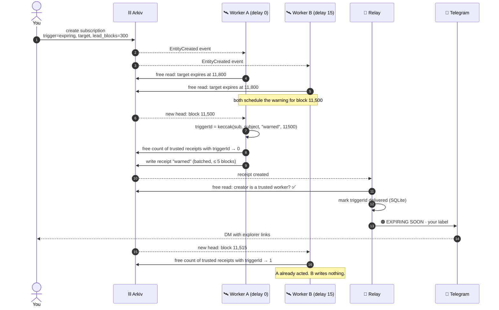

If worker A had been down, B would have counted **0** at block 11,515 and written the receipt itself, exactly 15 blocks (30 s) late. On the Activity page, worker B's row would count it as a delivery **only by B**, 15 blocks late.

---

## 🤝 Two workers, zero coordination

No locks. No leader election. No shared database. No network link between the workers. The coordination medium **is Arkiv**.

### The trigger id

Both workers name every trigger the same way:

```ts
triggerId = keccak256(encodePacked(subscription, subject, event, triggerBlock));
```

Same inputs → same id, on every worker. Every receipt stores it, so _"has anyone already acted on this?"_ is a single free count.

### The failover loop

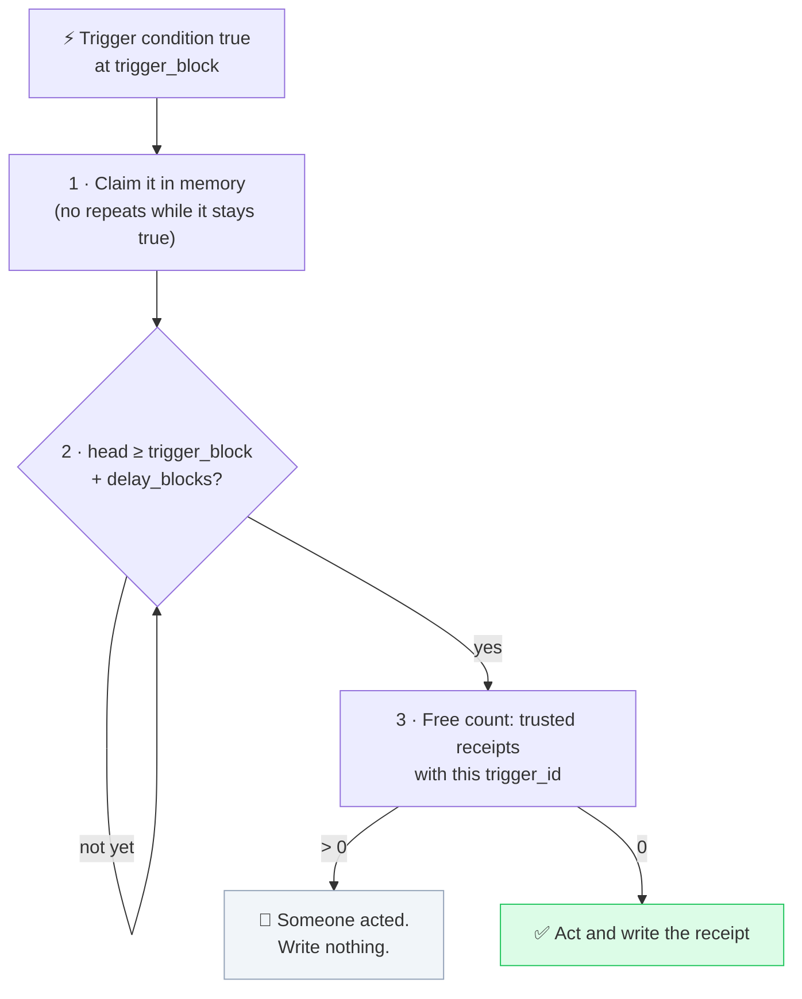

| Worker   | Region        | Address                                      | `delay_blocks`   |
| -------- | ------------- | -------------------------------------------- | ---------------- |
| Worker A | New York      | `0x6a693Fd642c1F8F5E78321C2722208A3791eE79B` | 0 (acts at once) |
| Worker B | San Francisco | `0xa70C8245582d173b04cAe453E9fF6D17a6e58294` | 15 (30 s)        |

**When both write anyway** (A's receipt hadn't landed when B checked), it's harmless:

- **One DM.** The relay dedupes on `trigger_id`.
- **One renewal.** Both compute the same new expiry. The second worker re-reads the target first, sees it already renewed, and records `keep_skipped` with `already_extended`; if both send at once, both set the same expiry, so the target is still renewed once.
- **One cap slot.** The daily alert cap counts per subscription across both workers.

### Liveness, for free

```mermaid
gantt
    title Worker heartbeat entity (30-min lifetime, renewed every 10 min)
    dateFormat HH:mm
    axisFormat %H:%M
    section Healthy
    renew      :milestone, 00:00, 0m
    renew      :milestone, 00:10, 0m
    renew      :milestone, 00:20, 0m
    renew      :milestone, 00:30, 0m
    renew      :milestone, 00:40, 0m
    alive while renewals continue :active, 00:00, 50m
    section Worker crashes at 00:20
    last renew :milestone, 00:20, 0m
    still shown as alive :00:20, 30m
    Arkiv deletes it → offline :crit, milestone, 00:50, 0m
```

The relay's `/health` and the Activity page both read it with one free count per worker.

---

## 🔬 Inside a worker

A worker keeps everything in memory and rebuilds it from Arkiv on every start. Only three small files live on disk.

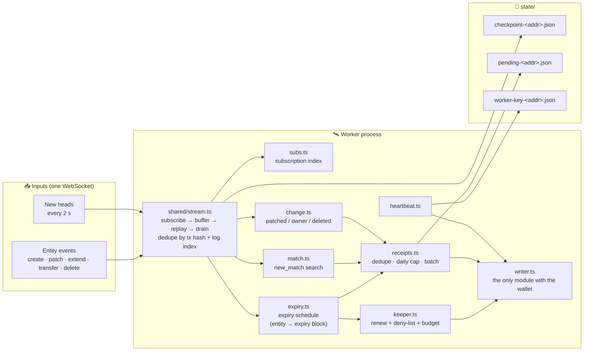

### Watching expiry without an expiry event

Arkiv sends no expiry event, so each worker keeps an **expiry schedule**: an in-memory map from each watched entity to its expiry block. It's filled at startup with one free read per entity, and kept current from events (a renewal moves the expiry, a delete removes it). On every new block the schedule is checked against the block number: **zero queries**. When an expiry block arrives, one free read confirms the entity is really gone (if it isn't, the worker missed a renewal and fixes its schedule).

### Never missing a block

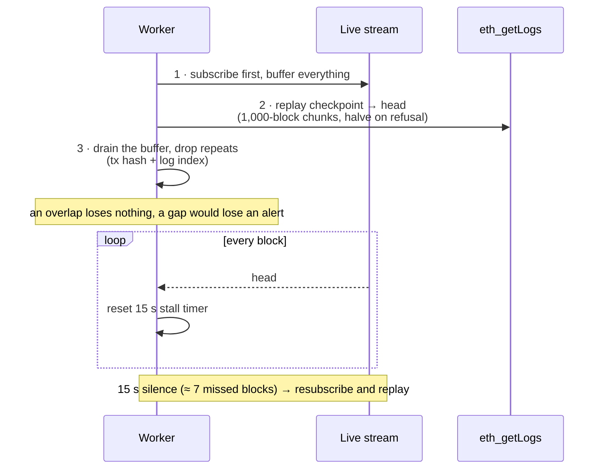

The checkpoint moves past a block only once **every** event in it is handled, so a crash replays from where the worker actually stopped.

### Startup sequence

1. **Load checkpoint** (first boot: start 1,800 blocks / 1 hour back; testnet wipe detected: start fresh).
2. **Discover subscriptions** (paged `arkiv_query`), decode and validate each; serve each wallet's oldest 20.
3. **Build the expiry schedule**; for targets already gone, search the last day of logs for their real expiry block so `expired` gets the same trigger id on every worker.
4. **Resume unsent receipts**, skipping any that already landed.
5. **Rebuild today's alert counts** from receipts on chain, so a restart doesn't reset `max_per_day`.
6. **Connect and catch up** (above), then go live.
7. **Start the heartbeat** and an **hourly re-sync** (Arkiv doesn't announce subscription expiry either).

Receipts are sent in batches (when 10 are queued or every 5 blocks, at most 50 per transaction). Graceful shutdown takes ≤ 5 s; a hard kill is still safe because pending receipts are on disk.

---

## 🗄️ Data on Arkiv: the three entities

Every entity Prometheus writes carries `project = "prometheus"`, so every query is scoped.

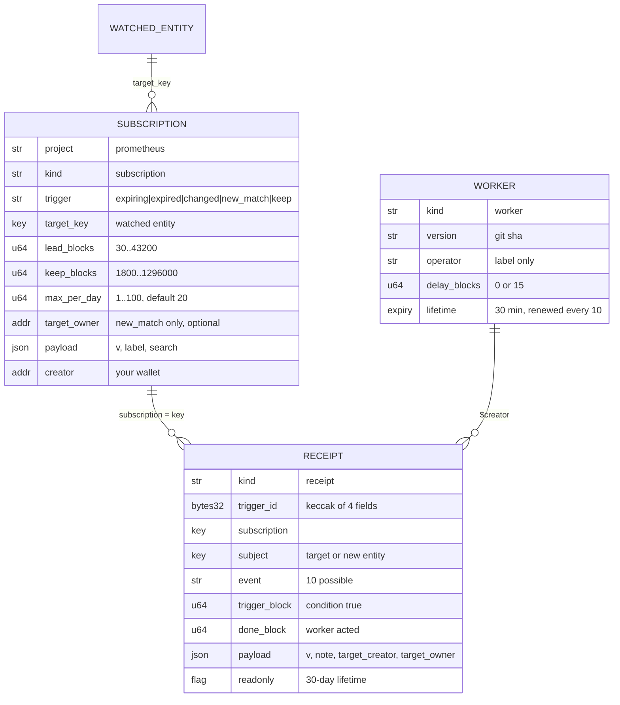

### Receipt events

| `event`            | From        | Status page shows      | Telegram headline        |
| ------------------ | ----------- | ---------------------- | ------------------------ |
| `warned`           | `expiring`  | Warning sent           | 🟠 EXPIRING SOON         |
| `expired`          | `expired`   | Not renewed by block X | 🔴 EXPIRED               |
| `patched`          | `changed`   | Changed                | ✏️ CHANGED               |
| `owner_changed`    | `changed`   | Owner changed          | 👤 OWNER CHANGED         |
| `deleted`          | `changed`   | Deleted                | 🗑 DELETED                |
| `matched`          | `new_match` | New matching record    | 🆕 NEW MATCH             |
| `kept`             | `keep`      | Kept alive             | ✅ RENEWED               |
| `keep_skipped`     | `keep`      | Renewal skipped        | ⏭ RENEWAL SKIPPED        |
| `keep_failed`      | `keep`      | Renewal failed         | ⚠️ RENEWAL FAILED        |
| `keeper_low_funds` | `keep`      | Worker low on funds    | _(operator only, no DM)_ |

**Lateness** = `done_block − trigger_block` (× 2 for seconds). 0–1 block shows as "on time". Worker B's receipts are always ≥ 15 blocks late by design.

Read any subscription's receipts yourself, no Prometheus code needed:

```text
project = str('prometheus') AND kind = str('receipt')
AND subscription = key(<your subscription key>)
AND ($creator = addr(0x6a693Fd642c1F8F5E78321C2722208A3791eE79B)
  OR $creator = addr(0xa70C8245582d173b04cAe453E9fF6D17a6e58294))
```

Canonical schema: [`arkiv/schema.md`](arkiv/schema.md) · Every query: [Data contract](web/docs/data-contract.md).

---

## 🛡️ Trust model: who you have to believe

| Data                             | Where          | Written by      | Public? |
| -------------------------------- | -------------- | --------------- | ------- |
| Subscriptions                    | Arkiv          | **your wallet** | yes     |
| Receipts                         | Arkiv          | worker A or B   | yes     |
| Worker heartbeats                | Arkiv          | worker A or B   | yes     |
| Which Telegram chat follows what | relay's SQLite | relay           | no      |
| Which triggers were already DM'd | relay's SQLite | relay           | no      |
| Free GLM claims                  | relay's SQLite | relay           | no      |
| Newsletter emails                | relay's SQLite | relay           | no      |

| Part    | You trust it to                         | It **can't**                                                                                                                      |
| ------- | --------------------------------------- | --------------------------------------------------------------------------------------------------------------------------------- |
| Arkiv   | store, expire, record who signed        | –                                                                                                                                 |
| Workers | act on time, write a receipt per action | change your subscription, rewrite a receipt, renew without owner permission                                                       |
| Relay   | DM every follower                       | write receipts that count, hide receipts from the status page                                                                     |
| Web app | list the right `TRUSTED_WORKERS`        | sign with MetaMask without your approval; a browser or Mini App key lives in the site's storage, so with one you trust the deploy |

**Why those "can't"s hold:** your subscription's `$creator` is your wallet; receipts are created `readonly` (deletion is a public event); non-owner renewal requires `permissionlessExtension`; the status page reads Arkiv through a pass-through that only adds an access key ([`api/rpc.ts`](api/rpc.ts)), or the public RPC; every DM links to its receipt on the explorer.

> [!NOTE]
> **The walk-away test.** If the Prometheus team disappeared tomorrow, your subscriptions are still public entities you own, and the code is MIT. A new worker finds every subscription with the same query ours uses: no export, no migration. You'd only re-follow in the new relay's bot and use a site that trusts the new workers.

> [!WARNING]
> Everything in a subscription is public, including its **label**. Don't put personal data in it.

Full detail: [Trust model](web/docs/trust-model.md).

---

## 📏 Limits

One block = 2 s, so 30 blocks = 1 min, 1,800 = 1 h, 43,200 = 1 day.

| Limit                                   | Value                             | Why                                         |
| --------------------------------------- | --------------------------------- | ------------------------------------------- |
| Warning lead (`lead_blocks`)            | 1 min – 1 day                     | Sensible window to react                    |
| Renewal size (`keep_blocks`)            | 1 h – 30 days, and > lead         | A tiny renewal would burn a worker's gas    |
| Alerts per subscription per UTC day     | 20 default, 1 – 100               | No chat flooding (renewals don't count)     |
| Subscriptions served per wallet         | oldest 20                         | Bounds work one wallet can create           |
| `new_match` search                      | ≤ 3 levels, ≤ 8 conditions        | Cheap to check against every new entity     |
| `new_match` subs checked per new entity | 50, oldest first                  | Throwaway wallets can't stall the worker    |
| Renewals per worker per UTC day         | 200                               | Nobody can drain a worker's gas             |
| Keeper reserve                          | 0.005 GLM                         | Gas kept for heartbeats and receipts        |
| Receipt lifetime                        | 30 days                           | A month of audit, then self-cleaning        |
| Subscription lifetime (web app)         | 1, 7 or 30 days                   | Forgotten subscriptions end on their own    |
| Free GLM (relay sponsor)                | 0.02 per user, 1 GLM / 24 h total | Onboarding without the faucet, abuse-capped |

Every number, with what happens when you hit it: [Limits](web/docs/limits.md).

---

## 🌐 The web app

One path-routed React bundle is **both** the website and the app, and the **same bundle runs as the Telegram Mini App**.

| Route          | Page             | What it does                                                                                                                                   |
| -------------- | ---------------- | ---------------------------------------------------------------------------------------------------------------------------------------------- |
| `/`            | Home             | Demo video, plus links to Watch, the SDK and Telegram                                                                                          |
| `/new`         | Watch            | The subscription form with a visual search builder; validates live with the workers' decoder                                                   |
| `/s/<key>`     | Status           | One subscription and its receipts, read straight from Arkiv (works even if relay and workers are down)                                         |
| `/mine`        | My subscriptions | Your wallet's subscriptions: renew, cancel, see "served / not served"                                                                          |
| `/activity`    | Activity         | Last 24 h of trusted receipts per watched record, missed alerts, and per worker: deliveries, lateness, health (old `/coverage` redirects here) |
| `/docs/<slug>` | Docs             | Rendered from [`web/docs/*.md`](web/docs), with search and an **Ask AI** panel                                                                 |

**Wallets:** a browser-generated key, MetaMask, or (inside Telegram) a key in Telegram SecureStorage (iOS Keychain / Android Keystore) or, on Telegram Desktop and Web, Telegram DeviceStorage. The browser never sees an Arkiv access key: [`vite.config.ts`](vite.config.ts) injects an explicit allow-list of build-time values only, and reads go through [`api/rpc.ts`](api/rpc.ts), a Vercel function that adds the key on the server. If it fails, reads fall back to the public RPC.

**For agents:** the build emits `/llms.txt`, `/llms-full.txt` and `/docs/<slug>.md`.

---

## 📨 The relay

One Node process ([`relay/index.ts`](relay/index.ts)) with three jobs:

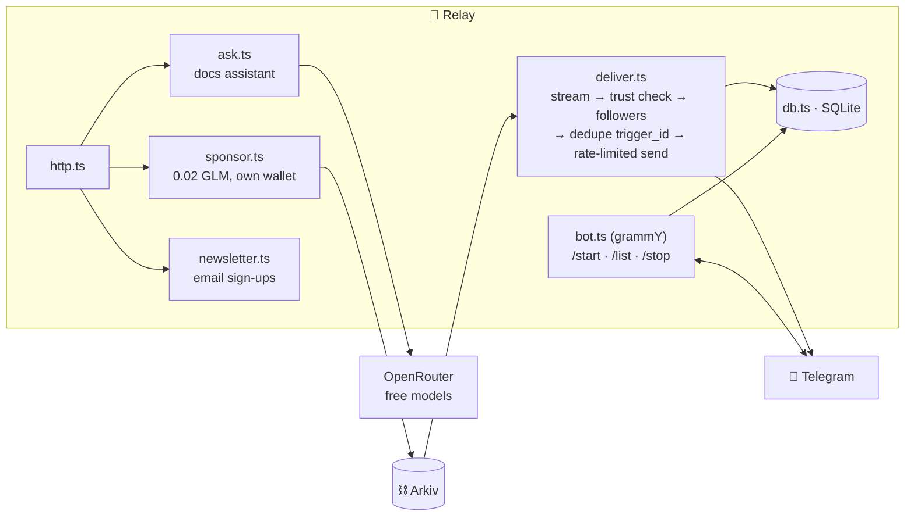

| Endpoint          | Purpose                                                                                                                             |
| ----------------- | ----------------------------------------------------------------------------------------------------------------------------------- |
| `GET /health`     | `{ ok, workersAlive: [...] }` from live heartbeats; cached 30 s so it can't drain quota                                             |
| `POST /sponsor`   | Sends 0.02 GLM to a new Mini App user; proves a real Telegram user via signed `initData`; one per user and per address              |
| `POST /ask`       | Streams an answer to a docs question; every docs page goes in one system prompt (no retrieval); daily cap; optional                 |
| `POST /subscribe` | Adds an email to the newsletter list in the relay's SQLite, never on Arkiv; same reply for new or repeat; per-IP limit              |
| `POST /subscribe` | Adds an email to the newsletter list in the relay's SQLite, never on Arkiv; same reply for new or repeat; 5 tries per IP per 10 min |

Live: `https://134-122-19-189.sslip.io` · Full API: [Network](web/docs/network.md).

Follow links pack the 32-byte subscription key as 43-char base64url, because Telegram caps `/start` payloads at 64 characters ([`shared/deeplink.ts`](shared/deeplink.ts)).

---

## 🗂️ Repository tour

```text
prometheus/
├── worker/            🛰️  the watcher: one process per worker wallet
│   ├── index.ts           entrypoint: config → discover → seed → stream → heartbeat
│   ├── subs.ts            discover + index subscriptions (oldest 20 per wallet)
│   ├── expiry.ts          the expiry schedule: expiring / expired / keep timing
│   ├── events.ts          dispatches live + replayed entity events
│   ├── change.ts          changed → patched / owner_changed / deleted
│   ├── match.ts           new_match: search evaluation via free counts
│   ├── keeper.ts          keep: deny-list, budget, reserve, renew + receipt in one tx
│   ├── receipts.ts        trigger dedupe, daily cap, batching, pending file
│   ├── writer.ts          the only module that holds the wallet (nonce-safe)
│   ├── heartbeat.ts       the 30-min worker entity
│   └── startup.ts         re-seed targets, rebuild day counts, hourly re-sync
├── relay/             📨  Telegram bot + delivery + HTTP API
│   ├── deliver.ts · bot.ts · db.ts · http.ts · sponsor.ts · ask.ts · newsletter.ts · index.ts
├── shared/            🧩  imported by worker, relay, web and SDK
│   ├── schema.ts          on-chain vocabulary + bounds (mirrors arkiv/schema.md)
│   ├── subscription.ts    THE decoder: what workers accept
│   ├── searchAst.ts       new_match search tree → Arkiv query
│   ├── triggerId.ts       keccak256(subscription, subject, event, triggerBlock)
│   ├── stream.ts          subscribe → buffer → replay → drain, stall timer
│   ├── replay.ts          checkpoints, wipe detection
│   ├── receipt.ts         parse receipts
│   ├── arkiv.ts           clients + free raw RPC calls
│   ├── config.ts          env validation (never prints values)
│   ├── deeplink.ts        Telegram start-payload encoding
│   └── limit.ts           request concurrency limiter (16 in flight)
├── web/               🌐  React 19 + Vite + Tailwind 4 (site + app + Mini App)
│   ├── docs/              16 Markdown docs pages (also served to agents)
│   └── src/               pages/, ui/, wallet.ts, telegram.ts, coverage.ts, …
├── sdk/               📦  prometheus-arkiv on npm
├── scripts/
│   ├── seed.ts            recreate the demo (targets + subscriptions) in one command
│   ├── probe.ts           measure what the design takes on trust (free calls, limits)
│   ├── watch-others.ts    watch other teams' public entities (watch-only, no keep)
│   └── openrouter-login.ts  get an OpenRouter key for /ask
├── arkiv/
│   ├── schema.md          the canonical on-chain contract
│   ├── friction.md        what was hard about Arkiv, with evidence
│   └── submission.md      failover rehearsal evidence
├── Dockerfile         one image for worker and relay (no build step)
├── compose.yaml       worker A + relay + Caddy on one host
└── vercel.json        web app deploy
```

---

## 💻 Run it locally

**Requirements:** Node **24+** (it runs `.ts` directly via type stripping), a funded testnet wallet per worker, a Telegram bot token for the relay.

```bash
git clone https://github.com/VanshChitransh/Prometheus.git
cd Prometheus
npm ci
cp .env.example .env        # shared values: RPC URLs, TRUSTED_WORKERS
npm run check && npm test   # tsc + prettier, then node --test
```

Config is layered: `.env` holds shared values, and each process adds its own file on top (later wins).

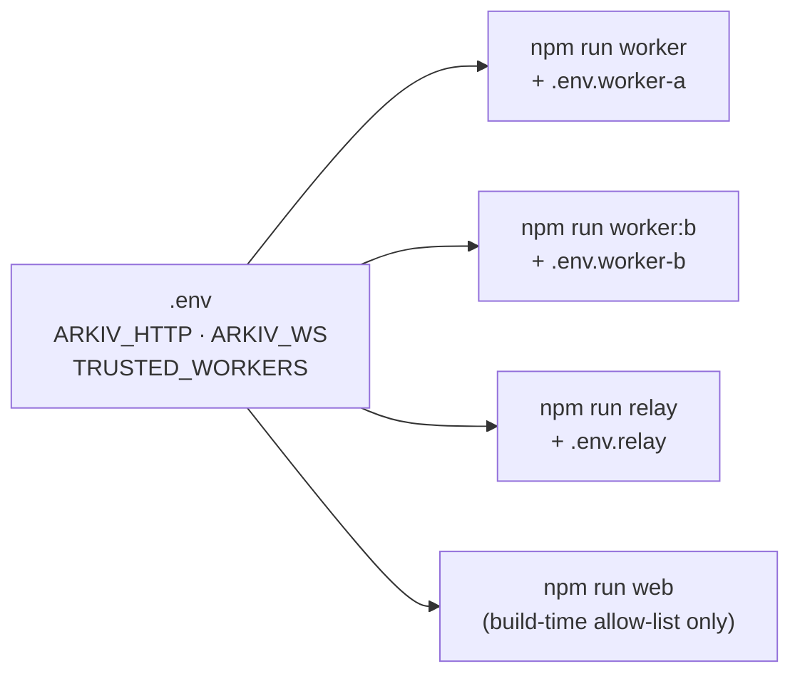

| Script                 | Does                                                           |
| ---------------------- | -------------------------------------------------------------- |
| `npm run worker`       | Worker A (`.env` + `.env.worker-a`)                            |
| `npm run worker:b`     | Worker B (`.env` + `.env.worker-b`)                            |
| `npm run relay`        | The relay (`.env` + `.env.relay`)                              |
| `npm run web`          | Vite dev server for the web app                                |
| `npm run web:build`    | Production build to `web/dist`                                 |
| `npm run seed`         | Demo targets + subscriptions; watch them fire in minutes       |
| `npm run probe`        | Re-measure Arkiv's costs and limits                            |
| `npm run watch-others` | Watch other teams' public entities (needs `WATCH_PRIVATE_KEY`) |
| `npm run check`        | Type-check + formatting                                        |
| `npm test`             | All unit tests                                                 |

<details>
<summary><b>⚙️ Every environment variable</b></summary>

| Variable                                                    | Used by                   | Notes                                                                 |
| ----------------------------------------------------------- | ------------------------- | --------------------------------------------------------------------- |
| `ARKIV_HTTP`, `ARKIV_WS`                                    | all                       | Tiramisu RPC (`https://` / `wss://`)                                  |
| `TRUSTED_WORKERS`                                           | workers, relay, web       | Comma-separated; must include the worker's own address; primary first |
| `ARKIV_ACCESS_KEY`                                          | workers, relay, web proxy | `X-API-KEY` header; **never** shipped to the browser                  |
| `WORKER_PRIVATE_KEY`                                        | worker                    | One key per running worker (two processes on one key race nonces)     |
| `WORKER_DELAY_BLOCKS`                                       | worker                    | `0` primary, `15` backup, ≥ `20` for a third worker                   |
| `SPONSOR_PRIVATE_KEY`, `TELEGRAM_BOT_TOKEN`                 | relay                     | Sponsor wallet is separate so it can't starve worker gas              |
| `RELAY_DB_PATH`, `PORT`                                     | relay                     | Default `state/relay.db`, `8080`                                      |
| `WEB_URL`                                                   | relay, seed, web          | Bot menu button, alert Status links, `llms.txt` URLs                  |
| `OPENROUTER_API_KEY`, `ASK_MODELS`, `ASK_DAILY_CAP`         | relay                     | Optional docs assistant (default cap 45/day)                          |
| `DEMO_PUBLISHER_PRIVATE_KEY`, `DEMO_SUBSCRIBER_PRIVATE_KEY` | seed                      | Demo wallets                                                          |
| `WATCH_PRIVATE_KEY`                                         | watch-others              | Its own wallet with a little GLM, separate from the demo subscriber   |
| `VITE_BOT_NAME`, `RELAY_PUBLIC_URL`                         | web build                 | Bot name; relay URL enables Mini App GLM, Ask AI, newsletter form     |

The config loader lists every problem at once and **never prints values**.

</details>

---

## 🚢 Deploy

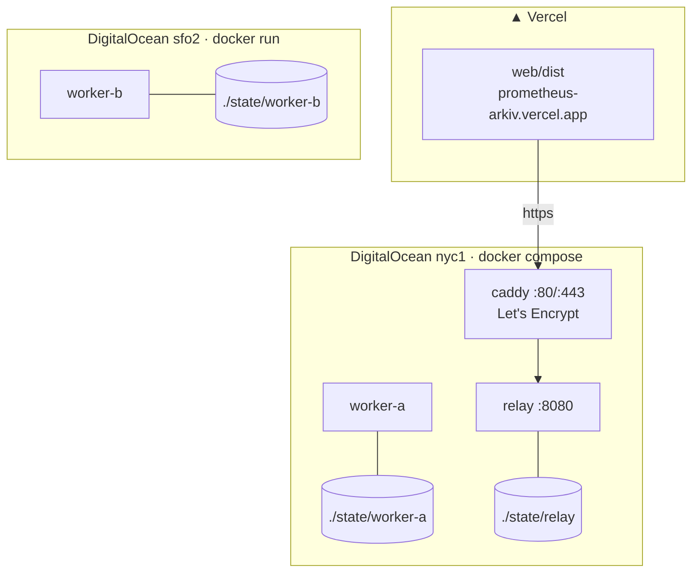

Two regions on purpose: one host or datacenter outage can't stop both workers. Telegram alerts come from the one relay on host A, so they pause while host A is down.

### Host A: worker A + relay + HTTPS

On the host, next to `compose.yaml`, create these files (`chmod 600`, never commit or bake into the image):

- `.env.worker-a`: `ARKIV_HTTP`, `ARKIV_WS`, `TRUSTED_WORKERS`, `ARKIV_ACCESS_KEY`, `WORKER_PRIVATE_KEY`, `WORKER_DELAY_BLOCKS=0`
- `.env.relay`: `ARKIV_HTTP`, `ARKIV_WS`, `TRUSTED_WORKERS`, `ARKIV_ACCESS_KEY`, `SPONSOR_PRIVATE_KEY`, `TELEGRAM_BOT_TOKEN`, optionally `WEB_URL`
- `.env`: `RELAY_HOST=<ip-with-dashes>.sslip.io` (or your own domain)

```bash
GIT_SHA=$(git rev-parse --short HEAD) docker compose up -d --build   # first deploy and every update
curl https://<your RELAY_HOST>/health                               # worker A in workersAlive
```

| Service    | Runs                        | Disk (`./state/…`)                     | Public    |
| ---------- | --------------------------- | -------------------------------------- | --------- |
| `worker-a` | `node worker/index.ts`      | checkpoint, unsent receipts, heartbeat | no        |
| `relay`    | `node relay/index.ts`       | follows (`relay.db`) + checkpoint      | via caddy |
| `caddy`    | HTTPS proxy to `relay:8080` | the certificate (`caddy-data` volume)  | 80, 443   |

> [!CAUTION]
> The `state/` folders **must survive redeploys**. Losing the relay's means every Telegram follow is gone. Firewall: inbound 22, 80, 443 only. Never run a second copy of worker A (nonce race) or the relay (Telegram refuses two pollers).

### Host B: worker B

Same image, another region, SSH-only firewall, no compose file. `.env.worker-b` has B's own key and access key and `WORKER_DELAY_BLOCKS=15`.

```bash
docker build --build-arg GIT_SHA=$(git rev-parse --short HEAD) -t prometheus .
docker run -d --name worker-b --init --restart unless-stopped --stop-timeout 10 \
  --log-opt max-size=10m --log-opt max-file=3 \
  --env-file .env.worker-b -v "$PWD/state/worker-b:/app/state" \
  prometheus node worker/index.ts
```

To update: rebuild, `docker rm -f worker-b`, run again. Deploy the **same commit** to both workers; each heartbeat publishes its `version` (the git sha).

### Web app

Vercel picks up [`vercel.json`](vercel.json): `npm ci` → `npm run web:build` → `web/dist`. Set `TRUSTED_WORKERS`, `WEB_URL`, `RELAY_PUBLIC_URL` and `VITE_BOT_NAME` as build env, and `ARKIV_ACCESS_KEY` as runtime env for `/api/rpc`.

---

## 🛰️ Run your own worker

Anyone can. You need a key, some GLM and a few settings (see the guide). The short version:

```bash
# 1. a key written straight to file, never printed
node -e 'const k="0x"+require("crypto").randomBytes(32).toString("hex");require("fs").appendFileSync(".env.worker-a",`WORKER_PRIVATE_KEY=${k}\n`)'
chmod 600 .env.worker-a

# 2. fund its address with GLM (paste its address into the faucet's Send to), then:
echo "WORKER_DELAY_BLOCKS=20" >> .env.worker-a     # a third worker behind A and B
# add your address to TRUSTED_WORKERS in .env

# 3. go
npm run worker
```

A healthy start logs `[subs] …`, `[startup] …`, `[stream] replayed … live` and `[heartbeat] worker entity live …`. Your receipts are public immediately; for the live relay and site to **count** them, your address must be in their `TRUSTED_WORKERS` (or run your own relay + site).

Full guide, log lines, costs and key hygiene: [Run a worker](web/docs/run-a-worker.md).

---

## 🧪 Proof: the failover rehearsal

On **17 Oct 2026** we seeded 6 short-lived targets and 8 subscriptions, then **stopped worker A** before the first trigger and **cut worker B's network for 40 s** mid-run.

| Result         | Observed                                                                                                          |
| -------------- | ----------------------------------------------------------------------------------------------------------------- |
| ✅ Failover    | All 8 triggers written by B, **each exactly 15 blocks late**, no duplicate `trigger_id`                           |
| ✅ Stall timer | B logged `no head for 15s: stall → resubscribe`, replayed 28 blocks, and still wrote its next receipt on schedule |
| ✅ Coverage    | Coverage page (now Activity) showed "covered by B", 0 delivered twice, no gaps                                    |
| ✅ Liveness    | A dropped out of `/health` 26.5 min after it stopped (heartbeat lapsed)                                           |
| ✅ Recovery    | A restarted, replayed 816 blocks, wrote **no** receipt for anything B had covered                                 |

Every receipt key and the queries to verify them yourself: [`arkiv/submission.md`](arkiv/submission.md).

---

## 🧱 What we learned building on Arkiv

We logged every friction point with evidence in [`arkiv/friction.md`](arkiv/friction.md) (also on the site as the [Friction report](web/docs/friction-report.md)):

1. The SDK's `getEntity` is a **paid** query, while the free `arkiv_getEntity` RPC isn't wrapped by the SDK.
2. `eth_getLogs` has **two caps** (100,000 blocks and 20,000 results) behind one error code, `-32602`.
3. The faucet funds the **signed-in wallet** unless you change **Send to**, and has no documented API.
4. A filtered count needs the raw RPC: the SDK's `getEntityCount()` takes no query.
5. `arkiv_getEntityCount` takes past blocks as `block` (a number) and **silently ignores** `atBlock` and other unknown fields.
6. Live events have **no filter and no backfill**, and an access key in the WebSocket URL leaks into viem's error messages.
7. The Tiramisu chain definition has **no `blockTime`**.

`npm run probe` re-measures the assumptions the design rests on.

---

## 🚧 Known limits

We'd rather you hear these from us. Found by our own audit on 17 Oct; Arkiv-side friction is in [`arkiv/friction.md`](arkiv/friction.md).

<details>
<summary><b>Worker</b></summary>

- **WK-4:** After a restart, `expired` is written only if the target's last create or extend was in the last 24 h.
- **WK-9:** A worker restart resets its daily keep budget.
- **WK-12:** A receipt sent just before a crash may be written twice; the relay sends one DM.
- **WK-13:** A transient RPC error during startup exits the worker; the container restart brings it back.
- **WK-14:** A subscription renewed during a re-sync may use its old expiry for up to an hour.
- **WK-15:** `new_match` evaluates at most 50 subscriptions per entity; past about 45 distinct searches, event handling lags.
- **F9:** A keep sets the target's expiry later. If the owner later extends by a shorter duration, Arkiv rejects it (`ExpiryNotExtended`) because the new expiry would be earlier; the owner must extend past our keep.

</details>

<details>
<summary><b>Relay</b></summary>

- **RL-2:** Labels are user-written. The bot shows them on one line, at most 80 characters, without link previews; a label can still name a domain.
- **RL-6:** A sponsor transfer that is broadcast but never mined is not re-offered; that user is pointed to the faucet.
- **RL-7:** Alert DMs are sent at most once. A DM still waiting when the relay crashes, or still backing off at the 5 s shutdown limit, or failing for about 8.5 minutes while Telegram is down, is not resent. Receipts on Arkiv and the Status page are unaffected.
- **RL-9:** A `keep_skipped(budget)` DM can be followed by a RENEWED DM from the other worker.
- **RL-10:** Follows from chats that blocked the bot stay until `/stop`; each DM to them fails fast and is dropped.
- **RL-11 / WB-27:** `relay/deliver.ts` (about 300 lines) and the web view (`.tsx`) files exceed the 200-line rule, and several worker/shared modules exceed it (largest: `worker/receipts.ts`, 414 lines); the web's logic lives in ≤200-line `.ts` modules with tests.

</details>

<details>
<summary><b>Ops & web</b></summary>

- **OP-3:** `/health` is checked by hand; Docker restarts the relay only when it exits.
- **WB-20:** `/new`'s 20-per-wallet check counts every live subscription of the wallet, including ones workers reject.
- **WB-21:** The site loads telegram.org's Mini App script on every visit; where telegram.org is blocked, the page waits for it to time out.
- **WB-22:** In Telegram on iPhone, Export key may not copy; the key stays in Telegram's secure storage.
- **WB-23:** After you make a browser key, MetaMask needs a click on each visit.
- **WB-24:** The lifetime ruler keeps moving when reduced motion is on.
- **WB-26:** Receipts show relative time and lateness in blocks, not the exact trigger block or the worker address; `/mine` doesn't mark public monitors.
- **WB-28:** `/mine` can label a subscription "served" while its target is gone.

</details>

<details>
<summary><b>Design-level</b></summary>

- **The relay is the one central piece.** If it's down, DMs stop; receipts and the status page keep working, and anyone can run another relay.
- **Arkiv's block production is centralised today**, so we claim Prometheus can be served without us, not that it's unstoppable.
- **Canary detection is a guess by name.** Your real protection is creating a canary without `permissionlessExtension`.
- **Free calls could be repriced.** The design still works with paid calls under an access key.
- **No block hash in the trigger id.** Tiramisu has a single block producer, so reorgs aren't expected.

</details>

---

## 🔭 What's next

Arkiv's [wishlist](https://hub.arkiv.network/ecosystem) asks for a network that "watches queries, reacts to entity expiration or state changes, **executes actions**, and writes signed receipts back to Arkiv". Prometheus does the watching, the reacting and the receipts. Today the only actions are an alert and a renewal. Next:

- **Webhooks.** A worker sends the receipt key to a URL the app chooses. The app reads that receipt on Arkiv and checks its `$creator` before acting, so it never has to trust the call itself. Apps react in code, not just in Telegram, and delivery no longer depends on our one relay.
- **An open worker network.** Today `TRUSTED_WORKERS` is a list we set. Every receipt already records who acted and how late (`done_block` minus `trigger_block`), so a worker's on time rate can be computed from Arkiv alone. Anyone could join, be scored by that record, and later be paid in GLM per receipt.
- **Value triggers.** Alert only when an attribute hits a value you pick, like a status turning to `halted`, not on every change.

---

## ❓ FAQ

<details>
<summary><b>Do I need to own the entity I watch?</b></summary>

No. Any live Arkiv entity works. Only `keep` has an extra requirement: the entity must allow permissionless extension.

</details>

<details>
<summary><b>Does Prometheus hold my keys or my data?</b></summary>

No. You sign your subscription with your own wallet; it's a public entity you own. The relay stores which Telegram chat follows which subscription, which alerts it already sent, free-GLM claims (Telegram user id and wallet address) and newsletter emails. None of it goes on chain.

</details>

<details>
<summary><b>What does it cost?</b></summary>

The gas to create a subscription: a tiny amount of testnet GLM (no real value). The Mini App gives you 0.02 GLM free. Workers pay for receipts and renewals.

</details>

<details>
<summary><b>What if worker A goes down?</b></summary>

Worker B covers it 30 seconds later, automatically. The receipt's lateness and the Activity page show it.

</details>

<details>
<summary><b>What if the relay goes down?</b></summary>

Telegram DMs pause. Workers keep writing receipts, and the status page (which reads Arkiv, not the relay) keeps working.

</details>

<details>
<summary><b>Why won't it keep my canary alive?</b></summary>

Because a canary's expiry is the signal. Renewing it automatically would hide exactly the silence it exists to show.

</details>

<details>
<summary><b>How do I verify an alert really happened?</b></summary>

Every DM links to its receipt on the explorer. Check the receipt's `$creator` is a trusted worker address, and its `trigger_block` / `done_block`.

</details>

---

## 📖 Glossary

| Term                  | Meaning                                                                              |
| --------------------- | ------------------------------------------------------------------------------------ |
| **Entity**            | One record on Arkiv, with attributes, a payload and an expiry block                  |
| **Key**               | An entity's address: `0x` + 64 hex                                                   |
| **Block**             | Arkiv's clock tick: one every 2 s                                                    |
| **Subscription**      | An entity you sign that tells workers what to watch                                  |
| **Trigger**           | The condition a subscription watches for (one of five)                               |
| **Worker**            | A program that watches the chain and acts on subscriptions                           |
| **Receipt**           | A read-only entity a worker writes every time it acts                                |
| **Trigger id**        | `keccak256(subscription, subject, event, triggerBlock)`: the same on every worker    |
| **Lateness**          | `done_block − trigger_block`                                                         |
| **Relay**             | The service that turns receipts into Telegram DMs                                    |
| **`TRUSTED_WORKERS`** | The worker addresses whose receipts count                                            |
| **`$creator`**        | The wallet that signed an entity's creation, recorded by Arkiv; trust is based on it |
| **GLM**               | The gas token on Tiramisu                                                            |
| **Checkpoint**        | The last block a worker or the relay fully handled                                   |
| **Heartbeat**         | A worker's 30-minute self-renewing entity: alive while it exists                     |

### Network reference

| Setting  | Value                                                 |
| -------- | ----------------------------------------------------- |
| Chain    | Arkiv Tiramisu testnet, id `7738577`                  |
| HTTP RPC | `https://rpc.tiramisu.db-chain.testnet.arkiv.network` |
| WS RPC   | `wss://rpc.tiramisu.db-chain.testnet.arkiv.network`   |
| Explorer | https://tiramisu.explorer.arkiv.network               |
| Faucet   | https://hub.arkiv.network/faucet                      |

### All docs

[Introduction](web/docs/introduction.md) · [How it works](web/docs/how-it-works.md) · [Quickstart: Telegram](web/docs/quickstart-telegram.md) · [Quickstart: developers](web/docs/quickstart-developers.md) · [SDK](web/docs/sdk.md) · [Without the SDK](web/docs/without-the-sdk.md) · [For agents](web/docs/for-agents.md) · [Triggers](web/docs/triggers.md) · [Receipts](web/docs/receipts.md) · [Workers and failover](web/docs/workers-and-failover.md) · [Trust model](web/docs/trust-model.md) · [Limits](web/docs/limits.md) · [Network](web/docs/network.md) · [Data contract](web/docs/data-contract.md) · [Run a worker](web/docs/run-a-worker.md) · [Friction report](web/docs/friction-report.md)

---

## 📄 License

[MIT](LICENSE). Run it, fork it, serve subscriptions without us. That's the point.

<div align="center">
<sub>Built for the Arkiv buildathon · 🔥 Prometheus brought fire; we bring receipts.</sub>
</div>
