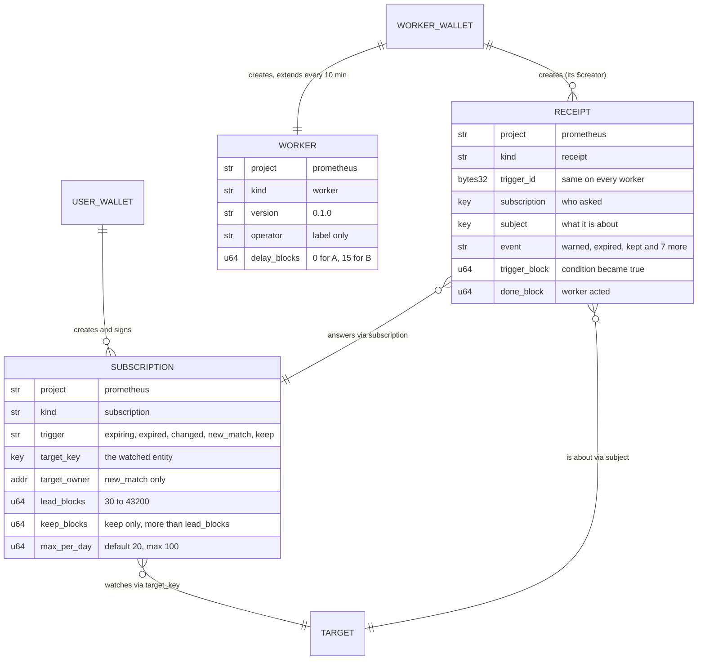
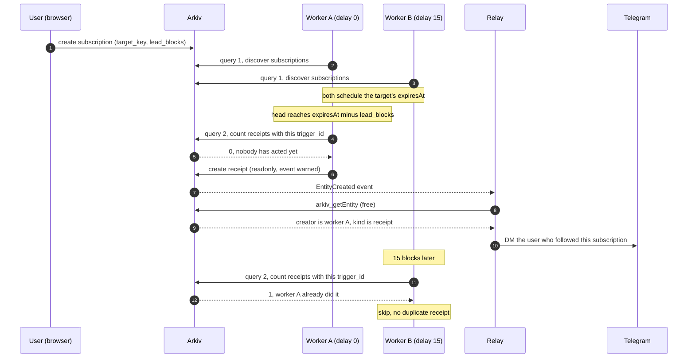

# Prometheus data contract on Arkiv

Everything Prometheus stores on Arkiv, who writes it, how long it lives, and the exact queries that read it back. Code mirrors this file in [`shared/schema.ts`](../shared/schema.ts). If the two disagree, this file wins.

Network: Tiramisu testnet. SDK: `@arkiv-network/sdk` 0.8.1.

## Rules for every entity

- Attribute names are **lowercase snake_case**.
- Every entity has `project = "prometheus"` and a `kind`. Every query filters on both, so we never read another app's data by accident.
- Anything we filter on is an **attribute**. The payload holds only data we display.
- Numbers we compare with `>=` / `<` are `u64`.
- **Trust comes from `$creator`, never from an attribute.** Anyone can write an entity with `kind = "receipt"`; readers only believe receipts whose `$creator` is a known worker wallet.

## Wallets that create entities

| Role            | Address                                      | Creates                            |
| --------------- | -------------------------------------------- | ---------------------------------- |
| Worker A        | `0x6a693Fd642c1F8F5E78321C2722208A3791eE79B` | `worker`, `receipt`                |
| Worker B        | `0xa70C8245582d173b04cAe453E9fF6D17a6e58294` | `worker`, `receipt`                |
| Demo publisher  | `0x07df075e19C8682E0BbF4D1B018BA3Ab8fD174F2` | the demo target entities           |
| Demo subscriber | `0xa286a6fc7bF81CE5A18cFB52CF9C2040724aC8Ee` | demo `subscription`s               |
| Any user        | their own wallet                             | `subscription`                     |
| Sponsor (relay) | `0x64E80982DEEfe1296CfD6483A30Fd4a46EbA7C22` | nothing; it only sends GLM top-ups |

## The three entities at a glance

`TARGET` is any entity on Arkiv, from any app. Prometheus watches it but never writes it.

| Entity         | Lifetime                        | Flags                                 | Why that lifetime                                   |
| -------------- | ------------------------------- | ------------------------------------- | --------------------------------------------------- |
| `worker`       | 30 min, extended every 10 min   | none                                  | expiry is the health check: a dead worker vanishes  |
| `subscription` | 1, 7 or 30 days (user's choice) | `permissionlessExtension` if opted in | a forgotten subscription ends on its own            |
| `receipt`      | 30 days                         | `readonly`                            | a month of auditable history, then it cleans itself |

## `worker`: "I am alive"

| Attribute      | Type | Example                                      |
| -------------- | ---- | -------------------------------------------- |
| `project`      | str  | `prometheus`                                 |
| `kind`         | str  | `worker`                                     |
| `version`      | str  | `0.1.0`                                      |
| `operator`     | str  | `team-a` (a label only; trust is `$creator`) |
| `delay_blocks` | u64  | `0` for A, `15` for B                        |

- **Payload:** `{ name, url, triggers: ["expiring","expired","changed","new_match","keep"] }`
- **Flags:** none. Only its owner (the worker) extends it.
- **Lifetime:** 30 minutes, extended by 30 minutes every 10 minutes.
- **Why:** expiry _is_ the health check. If a worker dies, it stops extending, and its entity disappears from Arkiv within 30 minutes with no extra code. A 3x margin (10 vs 30 minutes) survives two missed heartbeats.
- **Creator:** the worker wallet, once at first boot.

## `subscription`: "watch this entity for me"

| Attribute      | Type | Required for                     | Notes                                                                |
| -------------- | ---- | -------------------------------- | -------------------------------------------------------------------- |
| `project`      | str  | all                              |                                                                      |
| `kind`         | str  | all                              | `subscription`                                                       |
| `trigger`      | str  | all                              | `expiring`, `expired`, `changed`, `new_match` or `keep`              |
| `target_key`   | key  | expiring, expired, changed, keep | the watched entity                                                   |
| `target_owner` | addr | new_match (optional)             | only consider new entities from this owner                           |
| `lead_blocks`  | u64  | expiring, keep                   | act this many blocks before expiry; 30 to 43,200 (1 min to 1 day)    |
| `keep_blocks`  | u64  | keep                             | blocks added per extension; must be > `lead_blocks`; at most 30 days |
| `max_per_day`  | u64  | all                              | alert cap per UTC day; default 20, max 100                           |

- **Payload:** `{ v: 1, label }`, plus `search: <AST>` for `new_match` (a JSON tree, never a raw query string).
- **Flags:** `permissionlessExtension` only when the user ticks "anyone can renew". Otherwise none.
- **Lifetime:** 1, 7 or 30 days, chosen by the user. Renewing sets the expiry again from now.
- **Why:** a subscription the user forgets about **ends on its own**. Workers stop serving it, and no one has to clean up.
- **Creator:** the user, signed in their own browser. Workers never create subscriptions.

## `receipt`: "this happened, and this worker acted"

| Attribute       | Type    | Notes                                                                                                            |
| --------------- | ------- | ---------------------------------------------------------------------------------------------------------------- |
| `project`       | str     |                                                                                                                  |
| `kind`          | str     | `receipt`                                                                                                        |
| `trigger_id`    | bytes32 | `keccak256(subscription, subject, event, trigger_block)`: every worker computes the same id for the same trigger |
| `subscription`  | key     | the subscription that asked                                                                                      |
| `subject`       | key     | the target entity, or the newly matched entity                                                                   |
| `event`         | str     | one of the 10 events below                                                                                       |
| `trigger_block` | u64     | the block when the condition became true                                                                         |
| `done_block`    | u64     | the block when this worker acted; `done_block − trigger_block` = lateness                                        |

**Events:** `warned`, `expired`, `patched`, `owner_changed`, `deleted`, `matched`, `kept`, `keep_skipped`, `keep_failed`, `keeper_low_funds`.

- **Payload:** `{ v: 1, tx, note, target_creator, target_owner }`
  - `tx`: the extension transaction, for `kept`.
  - `note`: for `keep_skipped`, the reason: `not_permissionless`, `deny_listed`, `already_extended` or `already_expired`.
  - `target_creator` / `target_owner`: as last seen. An entity can be re-created under the same name after it expires, so the receipt pins _which_ one we watched.
- **Flags:** `readonly`. This blocks **edits**. The owner (the worker) could still delete a receipt, but that deletion is itself public on chain. So the claim is "**cannot be rewritten; deletion is publicly logged**", not "cannot be removed".
- **Lifetime:** 30 days.
- **Why:** long enough to audit a month of coverage, short enough that the chain doesn't keep old alerts forever.
- **Creator:** a worker wallet. Readers trust a receipt only if `$creator` is a trusted worker.

## Queries

`TRUSTED` below stands for `($creator = addr(<worker A>) OR $creator = addr(<worker B>))`.

"Free" means the call returns no `arkiv-cost` header (measured 16 Oct, see [friction.md](friction.md)). `arkiv_query` costs 100 units, about 1% of a key's quota, so paid queries are kept off every hot path.

| #   | Purpose                                       | Who              | Call                          | Query                                                                                                                                       |
| --- | --------------------------------------------- | ---------------- | ----------------------------- | ------------------------------------------------------------------------------------------------------------------------------------------- |
| 1   | Discover subscriptions                        | worker           | `arkiv_query`, paged (paid)   | `project = str('prometheus') AND kind = str('subscription')`                                                                                |
| 2   | Has a trusted worker fired this trigger?      | worker           | `arkiv_getEntityCount` (free) | `project = str('prometheus') AND kind = str('receipt') AND trigger_id = bytes32(<id>) AND TRUSTED`                                          |
| 3   | Today's alerts for a subscription (daily cap) | worker           | `arkiv_getEntityCount` (free) | `project = str('prometheus') AND kind = str('receipt') AND subscription = key() AND trigger_block >= u64(<dayStartBlock>) AND TRUSTED` |
| 4   | Receipts for one subscription                 | web `#/s/:key`   | `arkiv_query` (paid)          | `project = str('prometheus') AND kind = str('receipt') AND subscription = key() AND TRUSTED`                                           |
| 5   | Coverage (last 24 h)                          | web `#/coverage` | `arkiv_query` (paid)          | `project = str('prometheus') AND kind = str('receipt') AND trigger_block >= u64(<head − 43200>) AND TRUSTED`                                |
| 6   | My subscriptions                              | web `#/mine`     | `arkiv_query` (paid)          | `project = str('prometheus') AND kind = str('subscription') AND $creator = addr(<user>)`                                                    |
| 7   | Live workers                                  | relay, web       | `arkiv_getEntityCount` (free) | `project = str('prometheus') AND kind = str('worker') AND TRUSTED`                                                                          |

Notes:

- **#1** runs at startup and once an hour, not per block.
- **#2** is why `trigger_id` is deterministic: "did a worker already do this?" becomes one free count. If A and B race, two receipts share an id; the relay delivers once.
- **#2 and #3 must carry `TRUSTED`.** Anyone can compute a `trigger_id` from public data, so without the `$creator` filter a forged receipt from any wallet would make both workers skip the real alert (or eat a subscription's daily cap).
- **#3** uses `dayStartBlock = head − ⌊(now − UTC midnight) / 2 s⌋` (2-second blocks).
- **#4–#6** run once per page load, never on a timer, because the web app has no access key and shares the anonymous budget.
- Reading one entity by key (a receipt from an event, a target's expiry) uses the free raw `arkiv_getEntity [key]`, **not** the SDK's `getEntity()`, which is a paid `arkiv_query`.

## One alert, end to end

An `expiring` subscription, showing where each query from the table runs. Worker B waits 15 blocks, sees A's receipt and stays quiet; if A were down, B would write the receipt instead.

Every query string in the Queries table was rendered with the SDK's `eq` / `gte` / `and` and accepted by the Tiramisu node on 16 Oct 2026.
